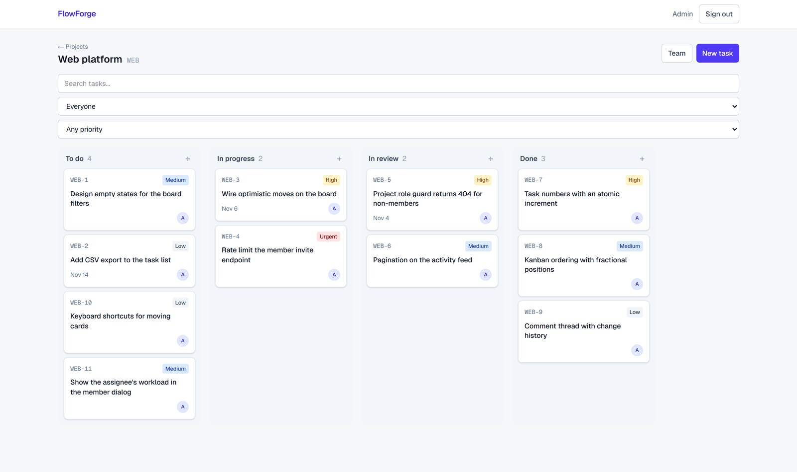
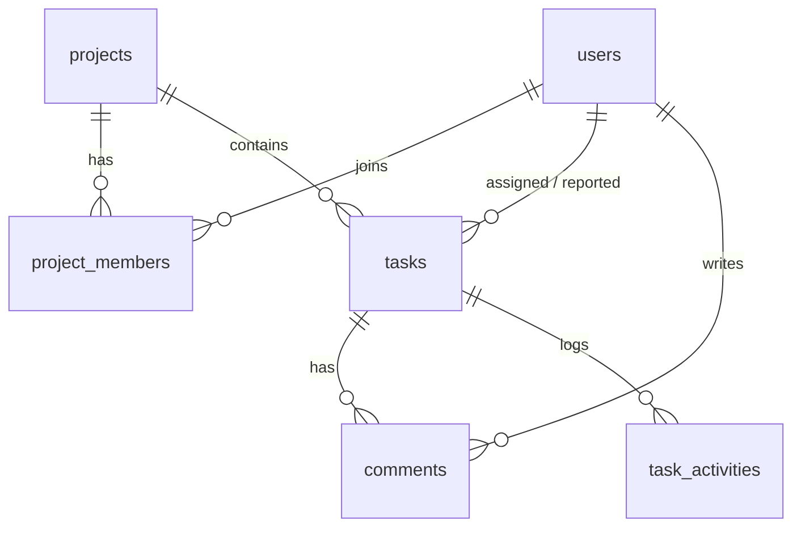

# FlowForge

[](https://github.com/Ahoura-CodeR/flowforge/actions/workflows/ci.yml)

A multi-user project management app in the spirit of Linear and Jira, at small scale:
projects, team roles, tasks, a drag-and-drop Kanban board, comments and a change history.

**Stack:** Next.js (App Router) · TypeScript · NestJS · PostgreSQL · TypeORM · TanStack Query

**Live demo:** https://flowforge-demo.onrender.com — sign in with `admin@flowforge.local` / `admin12345`, or create an account. The free instance sleeps when idle, so the first request after a pause can take about a minute to wake up.



## Features

- Accounts with JWT authentication and system roles (`admin`, `member`)
- Projects with per-project roles: `owner`, `member`, `viewer`
- Tasks with status, priority, assignee, due date and readable keys (`FF-12`)
- Kanban board with drag and drop; card order is persisted on the server
- Filters (status, priority, assignee, due dates), text search, sorting and pagination
- Comments, and an automatic change history showing who changed what
- Documented REST API (Swagger), database migrations, rate limiting, health check

## Run it

### With Docker

```bash
cp .env.example .env          # set DB_PASSWORD and JWT_SECRET (openssl rand -hex 32)
docker compose up -d --build
# optional: create an admin (set SEED_ADMIN_PASSWORD in .env first)
docker compose exec api node dist/database/seed.js
```

Web: http://localhost:3000 · API: http://localhost:4000/api · API docs: http://localhost:4000/api/docs

### For development

```bash
cd backend && cp .env.example .env && docker compose up -d   # PostgreSQL only
npm install && npm run start:dev                              # API on :4000

cd frontend && cp .env.example .env.local
npm install && npm run dev                                    # web on :3000
```

## Tests

```bash
cd backend  && npm test            # unit tests
cd backend  && npm run test:e2e    # API tests against a real PostgreSQL (database: flowforge_test)
cd frontend && npm test
```

The e2e suite covers authentication, role-based access at both levels, project and
membership rules, filters and pagination, history, comments and Kanban ordering. It needs a
PostgreSQL with the credentials in `backend/.env.example` and a `flowforge_test` database.
CI (`.github/workflows/ci.yml`) runs everything on every push.

## Architecture

```
frontend (Next.js)  ──HTTP/JSON──▶  backend (NestJS)  ──SQL──▶  PostgreSQL
 TanStack Query cache               guards, services            migrations
```



### Decisions worth knowing

- **Two layers of authorization.** A global guard checks the system role; a second guard checks
  the caller's role *in the project in the URL*. Non-members get a 404, so project existence
  is not revealed. Everything is protected by default; public routes opt out explicitly.
- **Roles come from the database, not the token**, so a role change or deleted account applies
  on the next request.
- **Integrity in the database where possible:** unique membership per (project, user), a partial
  unique index allowing a single owner per project, cascading deletes, and a unique
  (project, task number) pair.
- **Task numbers use an atomic SQL increment** inside the same transaction as the insert, so
  concurrent requests cannot collide (covered by a parallel-request test).
- **History is written in the same transaction as the change.** A pure `diffTask` function lists
  what really changed; edits that change nothing leave no entry.
- **Kanban ordering uses fractional positions.** A move updates one row; the column is re-spaced
  only if precision runs out. Moves lock the project row to avoid races.
- **The board updates optimistically** and rolls back if the server refuses the move.
- **Schema changes only through migrations**, applied automatically on startup.
- **Hardening:** validation that rejects unknown fields, bcrypt hashes that never leave the
  query layer, helmet headers, rate limiting (stricter on login and register).

## Known limitations

- Access tokens live 1 hour and there is no refresh token; the web app signs the user out when
  one expires. The token is stored in `localStorage` (an httpOnly cookie would be safer).
- No email flows (password reset, invitations): members are added by the email of a user who has
  already registered.
- No real-time updates: other users' changes appear on refetch, not instantly.
- Comments cannot be edited from the UI (the API supports it).

## Deploying

Any server with Docker works: set the variables in `.env`, point `WEB_URL` and `PUBLIC_API_URL`
at your real domains (the API URL is baked into the web build, so rebuild after changing it),
and put a reverse proxy with HTTPS in front (for example Caddy). Set `TRUST_PROXY=1` when you
do, otherwise rate limiting sees every visitor as the proxy.
